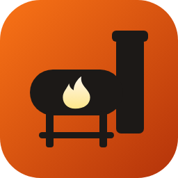

# Gravity 980 smoker controller

Local, cloud-free control and monitoring for the **Char-Griller Gravity Fed 980** charcoal smoker, built on an
**ESP32-S3** with **ESPHome** and **Home Assistant**.

**Today: a bridge.** The ESP32-S3 talks to the grill's *stock* controller over Wi-Fi (TCP) and/or Bluetooth; the
grill's controller still runs the fire. **It needs only the ESP32-S3 board**: no wiring, nothing inside the grill, no
probes of its own. Home Assistant is optional (see
[Running without Home Assistant](docs/standalone.md)). It adds:

- **Learning cook-time prediction** for every food probe: a physics model (warming → stall → finishing) fitted to the
  live data, seeded from your most similar past cooks (protein, weight, pit temperature, wrapped, weather) and
  corrected for how your grill actually holds temperature. Finish time with an early/late range, before the probe is
  even in the meat.
- **Stall detection** and stall-remaining estimates; "wrapped" switch that the model takes into account.
- **Cook programs** you can type on a phone: `pit 250 until food1 >= 165 for 30m; pit 275 until food1 >= 203; hold 200 notify "Rest it"`.
- **Alerts**: done / almost done, stall start and end, probe slipped out, pit off target, fire may be out, lid open,
  grill connection lost. Through Home Assistant (actionable notifications), with **ntfy** as a direct path for
  critical alarms when Home Assistant is down.
- **Home Assistant AI** (any `ai_task` entity): plan a cook from a sentence, a second-opinion ETA every 30 minutes,
  a review after each cook.
- **Six food probe slots**, each reading a probe plugged into the grill's controller, a **Govee H5198** directly over
  Bluetooth, or any temperature entity in Home Assistant. Plus a **Bluetooth proxy**: the closest radio to the grill.
- **Charcoal fuel gauge** from what you tell it (started ¾ full, topped up to ½, finished with ⅛), learning your
  grill's burn rate; low-fuel and "won't last to the finish" alerts.
- **Forecast-aware** finish times, a **pull-temperature and rest coach** (learned carryover and cooling), a
  **cook journal** with ratings, notes and curve comparison, **package photos read by AI** to set what's being cooked,
  and **voice** through Assist. See [docs/features-0.2.md](docs/features-0.2.md).
- **Control like the Char-Griller app**: pit and food targets, a timer, Turbo, and turning the grill on or off (two
  taps within 10 s, enforced by the controller). The controller's own page and the dashboard start in **Basic** (what
  the app does); switch to **Advanced** for programs, AI, charcoal, planning and the journal.
- **Dashboard**: a phone-friendly Home Assistant sidebar page, with AI recommendations (prep, lighting time, wrap point, weather effects).
- **Its own web page** at `http://gravity980.local`, working without Home Assistant or the internet, with a PIN.
- **Signed updates over the air**, optionally automatic while the grill is idle; **browser installer** for the first
  flash.

**Future (not built): a controller of its own** that would replace the stock one, drive the stock fan itself and take
probes wired straight into it (more food probes, zone probes, a chute thermocouple), maybe with a display. It needs
hardware the project hasn't built yet. What's built and what's future: [docs/features.md](docs/features.md); the
design: [docs/design.md](docs/design.md).

Estimates that need history (finish times, pull-at, the charcoal gauge) and anything from the AI are marked
**Experimental** until the controller has learned enough; see
[What's experimental](docs/features-0.2.md#whats-experimental).

## What you need

- **An ESP32-S3 N16R8 board**: 16 MB flash, 8 MB octal PSRAM, ESP32-S3-DevKitC-1 style, with a **BOOT button
  (GPIO0)** you can still reach once it's in its box (it's used for Bluetooth Wi-Fi setup and to clear a forgotten
  PIN). Boards with an IPEX/U.FL antenna socket work too.
- A **USB-C data cable** (some cables only charge) for the first flash, and a **5 V USB power supply** near the grill.
- A **plastic weatherproof box**: keep it away from the firebox; plastic lets Bluetooth and Wi-Fi through.
- **2.4 GHz Wi-Fi** within reach of the grill (the controller doesn't use 5 GHz).
- A **Char-Griller Gravity 980**. Other models are untested: reports welcome.
- Optional: Home Assistant 2025.11 or newer, a Govee H5198 thermometer.

That's all. (Parts lists for a future controller of its own, not needed today: [hardware/](hardware/BOM.md).)

## Quick start

1. Flash the ESP32-S3 from the [web installer](https://legal-copy7045.github.io/gravity-controller/) (Chrome/Edge).
2. Add the **Smoker** device in Home Assistant **within 15 minutes of plugging it in** (otherwise unplug it and plug it
   back in). Set **Grill IP address** on its device page, or rely on Bluetooth.
3. Install the **Smoker** integration from HACS, then its Home Assistant package: [docs/install.md](docs/install.md).
4. First session with the grill: [docs/first-run.md](docs/first-run.md).

**No Home Assistant?** Flash it, then open `http://gravity980.local`: [docs/standalone.md](docs/standalone.md).

Problems, or grill data to share (another model, odd readings): [open an issue](https://github.com/Legal-Copy7045/gravity-controller/issues/new/choose).

## Repository

| Path | What |
|---|---|
| `components/gravity980/` | ESPHome component: stock-controller protocol over TCP and BLE |
| `components/cook_assistant/` | ESPHome component: predictor, cook history, programs, alerts (pure C++ core + glue) |
| `firmware/` | Device configuration (`core.yaml`) and the prebuilt firmware entry point |
| `custom_components/smoker/` | Home Assistant integration: the Smoker sidebar dashboard |
| `homeassistant/packages/smoker.yaml` | Notifications, AI advisor/planner/review, ready-by planner, rest timer |
| `tools/fake_grill.py` | Simulated stock controller for testing without the grill |
| `tools/ble_probe.py` | Laptop tool to investigate the grill's Bluetooth protocol |
| `tests/` | Unit tests, end-to-end test (native firmware ↔ simulator), HA config check, dashboard render test |
| `hardware/` | Parts lists for a future controller of its own (not needed today) |
| `docs/` | Install, first run, standalone use, features (today and future), protocol, programs, predictor, future design and research; [embedding the page in another dashboard](docs/home-dashboards.md) (integrators) |

## Development

```bash
make -C tests                                   # core unit tests
esphome compile firmware/gravity980-bridge.yaml # ESP32-S3 firmware
esphome compile tests/host-bridge.yaml && python3 tests/e2e.py
python3 tests/ha_check.py && python3 tests/render_page.py
```

## Licence

MIT for this project's own code ([LICENSE](LICENSE)). The released firmware binary includes ESPHome's GPLv3 runtime
and is distributed under the GPLv3, with its source in this repository: see [THIRD_PARTY.md](THIRD_PARTY.md).

## Credits

This project builds on other people's published work. Their information was used; **none of their code was copied**
(the firmware, integration and pages were written for this project; checked against each source below).

- **[grzbiet/cg980app](https://github.com/grzbiet/cg980app)** (MIT): worked out the Gravity 980 controller's
  protocol (the Wi-Fi status frames, the target commands and the Bluetooth Wi-Fi setup). This project's own
  implementation is in C++ and was written from that documentation; [docs/protocol.md](docs/protocol.md) records what
  has been confirmed since.
- **The Char-Griller app** (Android): its code was read to find the Turbo and power commands, and its traffic
  recorded, purely for interoperability with the grill you own. Nothing from the app is included here; only the
  protocol facts are documented.
- **[govee-ble](https://github.com/Bluetooth-Devices/govee-ble)** (Apache-2.0), the library behind Home Assistant's
  Govee Bluetooth integration: the Govee H5198 advertisement format. The controller's own decoder was written from
  that format and checked against a real H5198.
- **[mantellian/chargriller-980-controller](https://github.com/mantellian/chargriller-980-controller)** (MIT) and
  **[HeaterMeter](https://github.com/CapnBry/HeaterMeter)**: ideas for the future controller's fan drive and
  door-switch handling ([docs/design.md](docs/design.md)). Nothing from them is in the firmware.
- **[Open-Meteo](https://open-meteo.com/)**: weather and place search on the controller. Weather data by
  Open-Meteo.com, under [CC BY 4.0](https://creativecommons.org/licenses/by/4.0/).
- **[ESPHome](https://esphome.io/)**, **[Home Assistant](https://www.home-assistant.io/)** and
  **[ESP Web Tools](https://github.com/esphome/esp-web-tools)**: the platforms it's built on. Libraries and licences
  in the firmware: [THIRD_PARTY.md](THIRD_PARTY.md).

Unofficial hobby project, not affiliated with or endorsed by Char-Griller.
